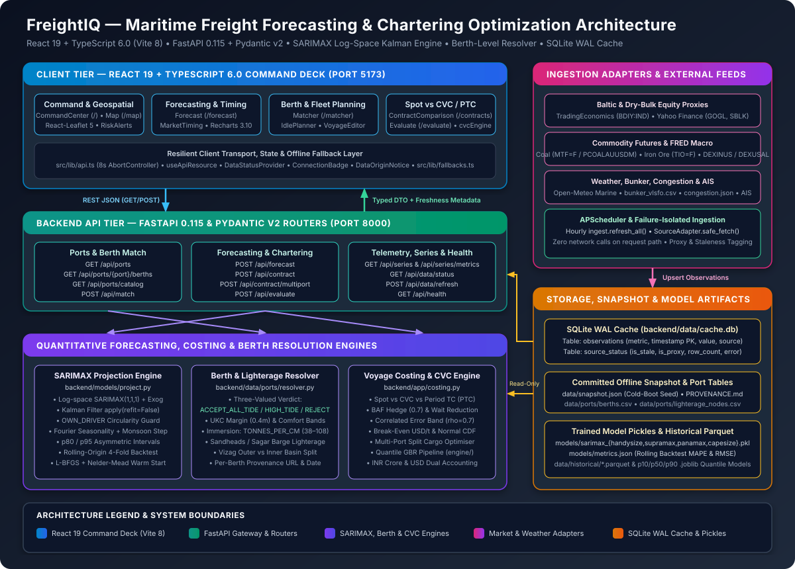

# FreightIQ: Predictive Maritime Freight & Chartering Optimization

[](https://react.dev/)
[](https://fastapi.tiangolo.com/)
[](https://www.statsmodels.org/)
[](https://leafletjs.com/)
[](https://recharts.org/)
[](LICENSE)

**FreightIQ** (`SIH_Freight-Forecasting`) is an offline-resilient maritime freight forecasting and bulk vessel-chartering decision platform engineered for dry-bulk cargo imports (thermal coal, coking coal, iron ore, limestone, fertilizers) across India's East Coast ports (**Paradip, Visakhapatnam, Gangavaram, Dhamra, Gopalpur, Haldia, and Sagar/Sandheads**). It pairs a **React 19 + TypeScript 6.0** analytical command deck with a **FastAPI + Statsmodels SARIMAX** quantitative backend that forecasts vessel-class freight rates (`Handysize`, `Supramax`, `Panamax`, `Capesize`) over 30-, 90-, and 180-day horizons, resolves berth-level physical compatibility with tidal and lighterage economics, and prices **Spot vs. Consecutive Voyage Charter (CVC) vs. Period Time Charter (PTC)** structures in both USD and Indian Rupee Crores (`₹ Cr`).

---

## System Architecture Overview



FreightIQ is structured around a strict **zero-network-on-request-path** architecture across five tiers:
1. **React 19 Operational Command Deck (`src/`)**: Ten specialized analytical views (`CommandCenter`, `Map`, `Forecast`, `Matcher`, `ContractComparison`, `Evaluate`, `MarketTiming`, `IdlePlanner`, `RiskAlerts`, `VoyageEditor`) backed by `useApiResource` with an 8-second `AbortController` timeout and automatic client-side fallback (`src/lib/fallbacks.ts`) when the backend is unreachable.
2. **FastAPI Async Gateway (`backend/app/`)**: Seven modular routers (`ports`, `match`, `forecast`, `contract`, `evaluate`, `series`, `status`) serving strictly from local SQLite WAL cache and pre-fitted model bundles.
3. **Quantitative Forecasting, Berth & Costing Engines**:
   - **Log-Space SARIMAX Engine (`backend/models/project.py`)**: Fits `SARIMAX(1, 1, 1)` models with z-scored exogenous regressors (`log_bdi`, `log_gogl`, `log_sblk`, `log_bunker`, `log_coal`, `log_iron_ore`, `log_usdinr`, `monsoon`, and annual Fourier terms `month_sin`, `month_cos`), applying the Kalman filter (`SARIMAXResults.apply(..., refit=False)`) at request time without re-estimating parameters.
   - **Berth-Level Physical & Lighterage Resolver (`backend/data/ports/resolver.py`)**: Evaluates vessel LOA, beam, commodity handling, and immersion draft (`TONNES_PER_CM`) against individual berth limits (`berths.csv`) and lighterage anchorages (`lighterage_nodes.csv`), returning commercially distinct `ACCEPT_ALL_TIDE`, `ACCEPT_HIGH_TIDE_ONLY`, or `REJECT` verdicts.
   - **Voyage Costing & CVC/PTC Arbiter (`backend/app/costing.py` & `engine/`)**: Prices multi-voyage import programmes across Spot, CVC (with BAF hedge and queue reduction), and Period Time Charter (PTC), including multi-port split discharges (`/api/contract/multiport`).
4. **Failure-Isolated Ingestion Adapters (`backend/data/adapters/`)**: Background `APScheduler` jobs pull TradingEconomics (`BDIY:IND`), Yahoo Finance (`GOGL`, `SBLK`, `MTF=F`, `TIO=F`), FRED (`DEXINUS`, `DEXUSAL`, `PCOALAUUSDM`), Open-Meteo marine weather, and reference CSV/JSON feeds via `SourceAdapter.safe_fetch()`.
5. **SQLite WAL Cache & Committed Snapshot (`backend/data/cache.db` & `snapshot.json`)**: On cold boot, `ingest.bootstrap()` seeds `cache.db` from the committed `data/snapshot.json` so every endpoint and model training script (`train.py`) works 100% offline.

For full architectural details, mathematical formulations, and data provenance rules, see [docs/ARCHITECTURE.md](docs/ARCHITECTURE.md).

---

## Prerequisites

| Requirement | Version / Details |
| :--- | :--- |
| **Python** | **CPython `3.11`, `3.12`, or `3.13`** (Preferred: `3.12`; avoids compiling `statsmodels`/`pandas` from source on 3.14) |
| **Node.js & npm** | **Node.js `v18.0+` / `v20+`** and `npm` |
| **Optional Package Manager** | `uv` (automatically detected by `./run.sh` to provision CPython 3.12 virtualenvs) |
| **External API Keys** | **None required** (all feeds are unauthenticated or degrade gracefully to cached snapshot data) |

---

## Step-by-Step Local Setup & Execution

### Option A: One-Command Orchestrated Launch (`./run.sh`)
The repository includes an idempotent process-group orchestrator (`./run.sh`) that provisions `backend/.venv`, installs Python and npm dependencies, fits the SARIMAX models if pickles are missing, and launches both the FastAPI backend (`:8000`) and Vite dashboard (`:5173`):

```bash
# Full setup, offline model training (if needed), and concurrent launch
./run.sh

# Useful flags:
./run.sh --setup      # Install dependencies and train models, then exit
./run.sh --backend    # Run FastAPI service only (:8000)
./run.sh --frontend   # Run React Vite dashboard only (:5173)
./run.sh --offline    # Run with FREIGHTIQ_OFFLINE=1 (blocks all outbound network calls)
./run.sh --retrain    # Refit all SARIMAX pickles before starting
./run.sh --test       # Execute backend pytest suite + frontend tsc, oxlint, and vite build
./run.sh --stop       # Terminate any processes listening on :8000 and :5173
```

### Option B: Manual Step-by-Step Setup (Windows PowerShell / Linux / macOS)

#### 1. Backend Setup & Model Training
```bash
cd backend
python -m venv .venv

# Activate virtual environment:
# Windows PowerShell:
.\.venv\Scripts\Activate.ps1
# Linux / macOS:
source .venv/bin/activate

# Install runtime and test dependencies
pip install -r requirements-dev.txt

# Fit SARIMAX models for all 4 vessel classes from the committed snapshot
python train.py

# Start the FastAPI server on port 8000
uvicorn app.main:app --host 0.0.0.0 --port 8000 --reload
```
Open `http://localhost:8000/docs` for the interactive OpenAPI / Swagger UI.

#### 2. Frontend Setup & Launch
In a second terminal at the repository root:
```bash
# Copy environment template (defaults to VITE_API_BASE=http://localhost:8000)
cp .env.example .env

# Install dependencies and start Vite dev server on port 5173
npm install
npm run dev
```
Open `http://localhost:5173` in your browser.

---

## Build, Verification & Testing Commands

```bash
# 1. Run backend pytest suite (berth resolution, economics, ingestion, invariants)
cd backend && pytest tests -q

# 2. Run root-level engine & property-based (Hypothesis) test suites
pytest tests -q

# 3. Type-check TypeScript (6.0), run Oxlint, and build production bundle
npm run lint
npm run build
```

---

## Configuration Mapping

All runtime parameters are controlled via environment variables (`backend/app/config.py` and `.env.example`):

| Environment Variable | Default Value | Tier | Description |
| :--- | :--- | :--- | :--- |
| `VITE_API_BASE` | `http://localhost:8000` | Frontend | Base URL for FastAPI backend requests (`src/lib/api.ts`) |
| `FREIGHTIQ_API_PORT` | `8000` | Orchestrator | TCP port used by `./run.sh` for Uvicorn |
| `FREIGHTIQ_WEB_PORT` | `5173` | Orchestrator | TCP port used by `./run.sh` for Vite |
| `FREIGHTIQ_OFFLINE` | `False` (`0`) | Backend | When `1`/`true`, blocks all outbound HTTP calls; adapters serve from `cache.db` |
| `FREIGHTIQ_SCHEDULER` | `True` (`1`) | Backend | Enables the background `APScheduler` job (`ingest.refresh_all`) |
| `FREIGHTIQ_REFRESH_MINUTES` | `60` | Backend | Interval in minutes between scheduled market data refreshes |
| `FREIGHTIQ_REFRESH_ON_STARTUP` | `False` (`0`) | Backend | Whether to trigger a live network pull immediately during FastAPI startup |
| `FREIGHTIQ_STALE_MINUTES` | `180` | Backend | Age threshold (minutes) after which `/api/data/status` flags a source as `is_stale` |
| `FREIGHTIQ_HTTP_TIMEOUT` | `15` | Backend | Timeout in seconds for outbound adapter HTTP fetches |
| `FREIGHTIQ_CORS_ORIGINS` | `http://localhost:5173,http://localhost:5174` | Backend | Comma-separated list of allowed CORS origins |
| `FREIGHTIQ_CACHE_DB` | `backend/data/cache.db` | Backend | Path to the SQLite WAL observation cache |
| `FREIGHTIQ_SNAPSHOT` | `backend/data/snapshot.json` | Backend | Path to the committed cold-boot snapshot file |
| `FREIGHTIQ_METRICS` | `backend/models/metrics.json` | Backend | Path to the rolling-origin backtest accuracy JSON |
| `FREIGHTIQ_AIS_FILE` | `backend/data/reference/ais_positions.csv` | Backend | Optional path to static MarineCadastre AIS CSV dump |
| `FRED_API_KEY` | Unset (Optional) | Backend | Optional FRED API key (falls back to unauthenticated `fredgraph.csv` if unset) |
| `TRADINGECONOMICS_KEY` | Unset (Optional) | Backend | Optional TradingEconomics credential for live `BDIY:IND` quotes |

---

## Documentation Index

- **System Architecture & Quantitative Design**: [ARCHITECTURE.md](ARCHITECTURE.md) | [docs/ARCHITECTURE.md](docs/ARCHITECTURE.md)
- **REST API & Schema Specification**: [API.md](API.md) | [docs/API.md](docs/API.md)
- **Developer Environment & Testing Guide**: [DEVELOPMENT.md](DEVELOPMENT.md)
- **Port & Berth Data Provenance**: [backend/data/ports/PROVENANCE.md](backend/data/ports/PROVENANCE.md)
- **Contribution Guidelines**: [CONTRIBUTING.md](CONTRIBUTING.md)
- **Security Policy**: [SECURITY.md](SECURITY.md)
- **Support & FAQs**: [SUPPORT.md](SUPPORT.md)
- **Product Roadmap & Vision**: [ROADMAP.md](ROADMAP.md) | [VISION.md](VISION.md)
- **Release Changelog**: [CHANGELOG.md](CHANGELOG.md)
