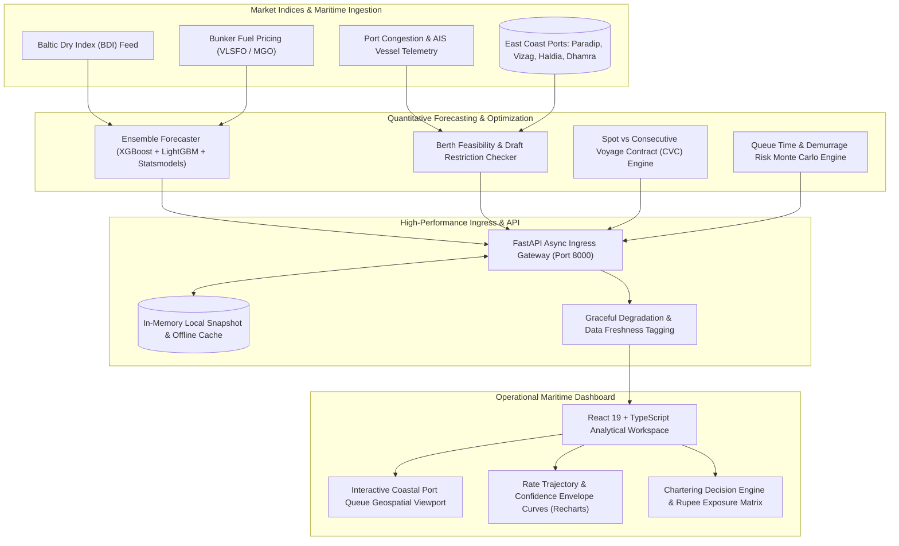

# FreightIQ: Predictive Maritime Freight & Chartering Optimization

[](https://react.dev/)
[](https://fastapi.tiangolo.com/)
[](https://xgboost.readthedocs.io/)
[](https://leafletjs.com/)
[](https://recharts.org/)
[](LICENSE)

> **Predictive freight rate forecasting and vessel-chartering optimization platform for bulk maritime cargo import logistics across India's East Coast major deepwater ports.**

---

## Architecture & Data Flow Diagram



---

## Core Features

- **Multi-Horizon Freight Forecasting**: Hybrid time-series ensemble combining gradient boosting (XGBoost, LightGBM) with statistical autoregressive models to project bulk commodity shipping rates over 30/60/90-day procurement cycles.
- **Berth Feasibility & Draft Matrix**: Real-time matching of incoming Capesize, Panamax, Supramax, and Handymax vessel dimensions against East Coast port parameters (Paradip, Visakhapatnam, Gangavaram, Dhamra, Gopalpur, Haldia).
- **Spot vs CVC Chartering Arbiter**: Quantitative optimization calculating rupee-denominated financial risk delta between locking long-term Consecutive Voyage Contracts versus spot market exposure.
- **Port Congestion & Demurrage Simulation**: Pre-berthing waiting time estimator and demurrage penalty risk calculator parameterized on real-time vessel turnaround queues.
- **Zero-Failure Offline Architecture**: Complete architectural decoupling guaranteeing all analytical dashboards render reliably offline with deterministic fallback caching and explicit freshness indicators.
- **Enterprise Design System**: High-contrast operations room interface with keyboard accessibility, command palette shortcuts (⌘K), live time clocks, and high-density KPI widgets.

---

## Tech Stack Directory

| Layer | Technologies |
| :--- | :--- |
| **Frontend Platform** | React 19, TypeScript 6.0, Vite 8, React Router DOM 7, TailwindCSS |
| **Data Visualization** | Recharts 3.10, Lucide React, React-Leaflet 5, Framer Motion |
| **Backend & Ingress** | FastAPI, Uvicorn (ASGI), Python 3.11–3.13, Pydantic v2 |
| **Quantitative ML** | XGBoost, LightGBM, Statsmodels, Scikit-learn, Pandas, NumPy |
| **DevOps & Verification** | Oxlint High-Performance Linter, Pytest, Hypothesis (Property Testing), Shell Automation |

---

## Quickstart & Verification

### Prerequisites
- **Python**: `3.11`, `3.12`, or `3.13` (CPython with pre-built binary wheels)
- **Node.js**: `v18.0.0` or higher
- **Package Managers**: `npm` and `pip` (or `uv`)

### Automated Setup
The unified orchestration script automatically sets up virtual environments, installs dependencies, trains the forecast models, and launches both services:

```bash
# Complete automated bootstrap and service launch
./run.sh
```

### Manual Execution & Verification
```bash
# 1. Start the React TypeScript Client
npm install
npm run dev

# 2. Configure and launch the Python ML Backend
cd backend
python -m venv .venv
# On Windows: .\.venv\Scripts\activate | On Unix: source .venv/bin/activate
pip install -r requirements.txt

# Fit the forecasting models from snapshot data
python train.py

# Launch FastAPI ASGI server
uvicorn app.main:app --host 0.0.0.0 --port 8000 --reload
```

---

## API & Route Specification

| HTTP Method | Route | Parameters / Payload | Expected Response | Description |
| :--- | :--- | :--- | :--- | :--- |
| `GET` | `/health` | None | `200 OK` + Service Status | Service health, model load state, and dataset freshness |
| `GET` | `/api/rates/forecast` | Query: `route`, `vessel_class`, `horizon_days` | `200 OK` + `ForecastResponse` | Rate predictions with 80%/95% confidence intervals |
| `GET` | `/api/ports/status` | Query: `port_id` | `200 OK` + `PortStatus[]` | Port queue depths, average turnaround, and weather alerts |
| `POST` | `/api/chartering/compare`| JSON: `CharteringQueryDTO` | `200 OK` + `ComparisonMatrix` | Spot market vs CVC exposure comparison and cost arbitrage |
| `POST` | `/api/berth/feasibility` | JSON: `VesselDimensionsDTO` | `200 OK` + `BerthFeasibility` | Verification of LOA, beam, and permissible draft across berths |
| `GET` | `/api/analytics/indices` | Query: `index_code`, `range` | `200 OK` + `HistoricalIndex[]`| Baltic Dry Index historical trajectories and bunker spreads |
